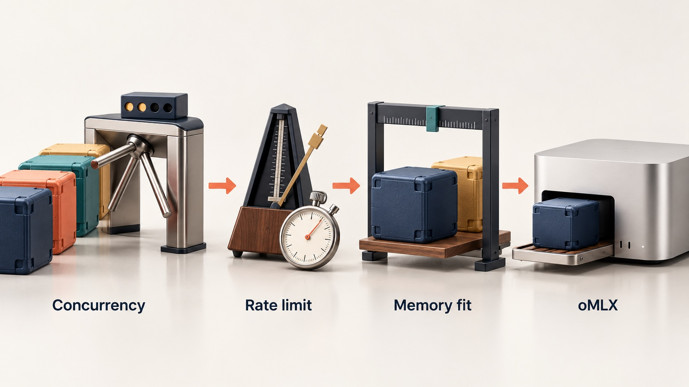
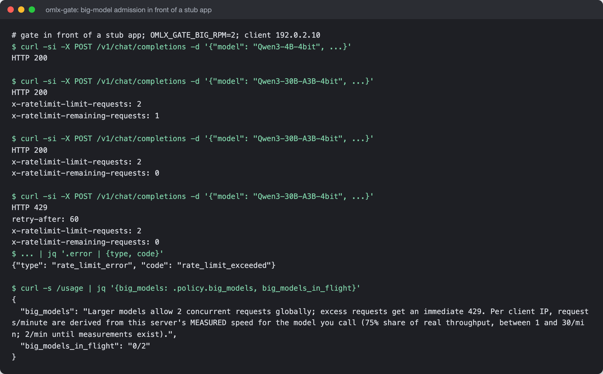

# omlx-gate

Admission control for large models on a shared Apple Silicon inference
server, attached to [oMLX](https://github.com/jundot/omlx) as ASGI
middleware.


## What it is

omlx-gate sits in front of oMLX's OpenAI- and Anthropic-compatible
generation endpoints and decides, per request, whether a large model may
run now. Small models (4B parameters or fewer by default, read from the
model name) pass untouched. Larger ones get a global concurrency cap, a
per-client rate limit derived from measured service time, a memory fit
check before a model swap, and a cap on model loads per minute. Every gated
response carries rate-limit headers and a suggested pacing interval, and
`GET /usage` returns the whole live contract (limits, measured timings,
loaded models, memory headroom) as one JSON document.

## Why it exists

A single Mac with unified memory can hold one or two large models at a
time. Several clients on the network sending requests to big models at
once either queue behind each other until requests time out, or force
model swaps that each take several seconds and can run the machine out of
memory. oMLX's own memory guard refuses such requests with low-level error
text that tells a client nothing about what to do next. The gate keeps the
server responsive for everyone and tells each client how to pace itself.

## How it works



`BigModelGateMiddleware` is a pure ASGI middleware (no
`BaseHTTPMiddleware`, so streaming responses pass through without an extra
pipe layer). For a request to a gated path it reads the body once, extracts
the model id, and runs three checks in order: concurrency (at most
`OMLX_GATE_BIG_CONCURRENCY` big requests in flight, else 429), rate (a
sliding 60-second window per client IP and model, with the limit computed
as `60 s x slots x share / EWMA(service seconds)` and clamped; cold-load
requests are excluded from the average), and fit (if the model is not
resident and cannot fit beside what is loaded, a 507 that names the
resident model and the swap commands). Measured service times and an event
log persist in SQLite so limits survive a restart. All coupling to oMLX
internals is isolated in one function in `pool.py`; `launch.py` attaches
the middleware to oMLX's app and hands the command line to oMLX's own CLI
unchanged, so oMLX stays a pinned, unmodified dependency instead of a fork.

The real middleware in front of a stub app, with the fallback limit set to
2 requests a minute. The requests are sent in-process through httpx's ASGI
transport (no oMLX, no GPU); the `curl`/`jq` lines label each step.



## Features

- Size classification from the model id (the largest `<n>B` wins, so an
  MoE model is bounded by total parameters, not active ones).
- Global concurrency cap for big models.
- Adaptive per-IP, per-model requests-per-minute from an EWMA of measured
  request time, with floor, ceiling and fallback before samples exist;
  loopback can be exempted from the rate window but never from the
  concurrency cap.
- Memory fit pre-check with a readable 507 instead of a kernel-level error.
- Swap thrash guard: model unloads always allowed, loads capped per minute.
- Feedback headers (`x-ratelimit-*`, measured average and last request
  seconds, suggested interval) and `Retry-After` on every 429.
- `GET /usage` and `/v1/usage` self-describing contract.
- Startup tripwires that log an error on a loopback bind or a second oMLX
  server process.
- Configuration entirely by `OMLX_GATE_*` environment variables.

## Stack

Python 3.11-3.13, ASGI on oMLX's FastAPI app, SQLite (stdlib `sqlite3`),
stdlib logging with an entry/exit/duration decorator; pytest and
pytest-asyncio for tests. oMLX is pinned to a git tag (v0.6.2).

## Run it locally (for review)

The tests need FastAPI but not oMLX itself:

```bash
uv run --no-project --with fastapi --with pytest --with 'pytest-asyncio>=0.21' \
  --with httpx python -m pytest -q
```

Running the server needs an Apple Silicon Mac and oMLX; the console script
`omlx-gate serve ...` takes the same flags as `omlx serve`.

Free for personal and non-commercial use with credit; commercial use needs
a licence. See [LICENSE](LICENSE) (PolyForm Noncommercial 1.0.0).

## Project status

v0.1.0. The author's own inference server was cut over to it on
2026-08-22. 29 unit tests cover classification, the three admission
checks, the swap guard and `/usage`. Rate-limit rejections carry a
deliberately informal sign-off in their message text.

## How it was built

The gate began as a patch inside a private fork of oMLX that had fallen
168 commits behind upstream. On 2026-08-22 it was extracted into this
package in three proven steps (extract, re-pin to upstream v0.6.2, cut the
live server over), each checked on a scratch instance before the live one
was touched. The full story is in [docs/BUILD-STORY.md](docs/BUILD-STORY.md).

## Credits

- [oMLX](https://github.com/jundot/omlx), the MLX inference server the
  gate attaches to.

## Author

Rico Rojas, https://rico-rojas.com
